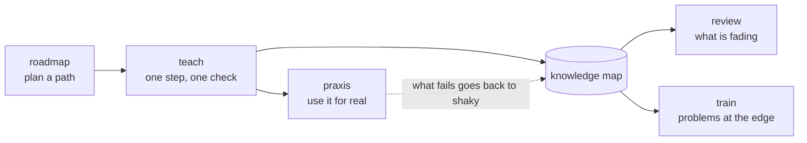

# Teaching

The method lives with the tutor, not in the app: skills say how to teach, subagents check facts and draw, and the MCP tools are the only way the tutor reaches the learner. The app enforces nothing about pedagogy; it records and shows. So changing how Aristotle teaches is mostly editing Markdown in `.claude/`, and every tutor reads the same Markdown ([below](#any-tutor)).

The idea behind it is Eero Alvar's "Bodybuilding for the Mind": struggle at the edge of what you can do is the training signal, and AI is the equipment that finds and loads that edge ([README](../README.md#the-method)).

## The loop

- **teach** probes what the learner knows, plans the map of what depends on what, then teaches one reasoning step per `show`, checking each with `quiz` or `ask` before moving on. It ends with `end_session` and a handoff.
- **review** practises concepts whose FSRS card says they are fading, by recall in writing, and records results with `record_practice`.
- **train** gives problems just above their level and moves the topic's training level as they solve them cleanly.
- **roadmap** plans an ordered path of topics with them (draft, then active), each step a topic.
- **praxis** designs a mission that puts a finished step to work in their own life, and reviews their debrief.

## Skills and subagents

<!-- generated: skills -->
| Kind | Name | What it is for |
|---|---|---|
| skill | [`praxis`](../.claude/skills/praxis/SKILL.md) | Praxis missions in Aristotle. |
| skill | [`review`](../.claude/skills/review/SKILL.md) | Spaced review in Aristotle. |
| skill | [`roadmap`](../.claude/skills/roadmap/SKILL.md) | Plan a roadmap with the learner in Aristotle: an ordered path of topics towards something bigger, each with its own goal, agreed with them before any of it is taught. |
| skill | [`teach`](../.claude/skills/teach/SKILL.md) | Teach the learner something in Aristotle so it is understood, not memorised. |
| skill | [`train`](../.claude/skills/train/SKILL.md) | Training sets in Aristotle. |
| agent | [`illustrator`](../.claude/agents/illustrator.md) | Draws a small, correct SVG diagram for one teaching step (optionally animated), checks it by rendering it in both themes, and returns the finished SVG. |
| agent | [`researcher`](../.claude/agents/researcher.md) | Fact-checks claims and scopes topics for the tutor. |
<!-- /generated -->

## Any tutor

Claude Code is the default tutor, and the skills are written for it. Any other tutor gets the same method, in the way it can take it:

- **AGENTS.md** holds the rules every sitting keeps (below) and the project's instructions; [`CLAUDE.md`](../CLAUDE.md) imports it, and Codex, opencode, Cursor, Copilot, Amp, Goose and Crush read it themselves (Gemini CLI because `.gemini/settings.json` says so).
- **`method`**, an MCP tool every client but Claude Code is offered ([`method.ts`](../server/method.ts)), returns a skill (teach, review, train, roadmap, praxis) or a subagent's instructions (researcher, illustrator), after a paragraph on what Claude Code's names stand for elsewhere ("the terminal", the subagents, ToolSearch) and, for a client that may not have read AGENTS.md, the rules every sitting keeps. The server's instructions point to it. The skills are also MCP **prompts**, which Gemini CLI, Qwen Code, opencode and others offer as slash commands.
- **The learner's profile** is the MCP tool `profile`, not a file, so a tutor without file access (or running elsewhere) reads and keeps it too.
- **Waiting for the learner** works in every agent the drawer runs: Codex gets a tool timeout past the longest wait on its command line, Gemini CLI in `.gemini/settings.json`, opencode keeps a call alive while progress arrives, and a client that can't wait more than a minute (Cursor's CLI) is answered in pieces.
- **Aristotle's own tutor on a model API** ([`tutor-api.ts`](../server/tutor-api.ts)) is told all of the above in its instructions, plus the list of skills to read with `method`; it checks facts with `web_search` and `read_page` instead of the researcher, and draws what the visual kit can't by following the illustrator's instructions itself (checking with `preview_svg` when the model can see images; a model that can't is steered to the kit's blocks).

A request from the interface says which skill to use in words ("Use the teach skill to teach me: …") for any tutor but a running Claude Code, which gets the slash command (`/teach …`).

## Rules every skill keeps

These are in [`AGENTS.md`](../AGENTS.md) (which [`CLAUDE.md`](../CLAUDE.md) imports) because they hold whichever skill is running:

- The learner reads and answers **in Aristotle, not the terminal**: teaching through `show`, graded checks through `quiz`, open questions through `ask`. Terminal replies are a line or two.
- **One reasoning step per `show`**, then a check.
- **The knowledge map stays true** (`update_map`): what is solid, what is shaky and why, what rests on what.
- **No stop button, and no hanging on a question.** `quiz` and `ask` hold the tutor's call for `ARISTOTLE_WAIT_MS` (3 minutes) from when they were asked. With no answer by then they return "No answer yet": he may be thinking it over or away, so the tutor ends its turn and the sitting stays open, instead of a call held for many minutes that reads as stuck. His answer, whenever it comes, brings it back: the page tells a tutor still holding the sitting to `collect_answers` and carry on (or, after a long gap, continues the class afresh, and `start_session` picks the open sitting up). A sitting is closed with a handoff when he says he is done, the goal is reached, or another sitting starts.
- **He moves between classes freely: nothing holds him to the sitting going on.** A question left open in any class, review or training set can be answered at any moment, even while the tutor is teaching another one. Answering it makes its sitting the current one; the sitting he left closes where it was, its own open questions answerable whenever he goes back. The tutor follows him without asking: a `quiz`, `ask` or `collect_answers` waiting in the sitting he left returns at once saying where he went, and until the tutor calls `start_session` on it, `show`, `quiz` and `ask` refuse with the same message (nothing of the class he left lands in the one he is in), while `update_map` and `end_session` still go to the sitting the tutor was in, so it is closed with its handoff. Continuing another class from the interface while a question waits does the same: the wait gives way at once (`POST /api/leave`), and the request follows as his message. Coming back to the first class picks it up at the same step.
- **Questions outlive their session.** One left unanswered stays answerable in the class page after the session ends, in any earlier session too, whatever is going on: answering it makes its session the current one again. When they answer one that no tool call is waiting for, Aristotle tells Claude: "collect my answers" if its session is still going, otherwise it continues the topic (or the review or training). So `start_session` hands over any such answers itself, those of the session it closes included; the skills need no separate `collect_answers` to start. A review is picked up again like a lesson: when the last review still has a question open or an answer the tutor hasn't had, `start_session` reopens it instead of starting a new one, so his answer and its feedback stay in one record.
- **Leaving and coming back lands on the same step.** A lesson or training set whose topic's last sitting still has a question open, or an answer Claude hasn't had, is picked up again by `start_session` instead of a new session being opened (which the class would show as a new step). Its result lists the open questions and tells Claude not to teach the step again: one line saying they are waiting, then `collect_answers` with `wait: true`, which waits on them as `quiz` and `ask` do.
- **Every course ends with its final mission, on its own**: when the last class is done, `teach` hands to `praxis`, which designs and saves the capstone without proposing it first. Missions for single classes only when they ask. Planning a course asks where they will use it (`use`), and `read_about` (their About you page) comes before anything inferred, so missions fit anyone.
- **The chat beside a lesson is not the tutor**: a second Claude answers them while they read, with their screen as context, without moving the lesson or giving away a check's answer. `get_topic` shows the tutor what they said there.
- **What they wondered about reaches the tutor**: `get_topic` lists the phrases they glossed and the questions they asked on passages of the topic. Both are gaps they noticed themselves, worth a check or a step.
- **Hover cards are the tutor's to write** (a highlighted term carries its definition inside the highlight): `{{term|definition}}` and `[[concept-id]]` only exist where Claude puts them, so `show` answers a teaching step that has neither with a reminder to add them in the next steps, and names any `[[link]]` that finds no concept (it would show greyed out, with no card). A bare `[[concept-id]]` is looked for in the session's topic, or, in a review (which has none), in the topic of the step's `concept`.
- **A review only practises what he has learned.** It never teaches something new: in a review session, `show`, `quiz` and `ask` refuse a `concept` that is on no map or is `unknown` on its map (shaky ones pass, since a review may repair them), and `show` warns about links to one. New material goes in a lesson; the review names it in its handoff. A review's steps are not numbered (the page labels them "Review"), since it is no sequence of lesson steps.
- **The agent in the drawer starts when Aristotle opens** (Claude Code, unless Settings chose another), idle in the terminal drawer, so the first request never waits for it to boot; what is sent while it starts is typed in once it is ready. The API tutor has nothing to start.
- **Pictures for anything physical, spatial or timed** (in `teach`): an explorable first, then the visual kit, a real image as a `plate`, and an illustrator SVG last. A `flow` that moves real things draws them (`art`, `carries`, `makes`: glucose in, electrons along, ATP out), and their numbers are facts like any other.
- **Accuracy first**: verify any fact, name, date or formula before teaching it (the `researcher` subagent, or a web search for a tutor without it), and mark real uncertainty.
- **Fewer turns, sooner steps.** Each model turn costs the learner a second or more, while a tool call costs milliseconds, so the skills send calls that belong together in one message, in order: a step's `show` and then its `quiz` or `ask` (Claude Code runs a call as soon as its part of the message is written, so the step appears while the question is still being written); feedback's `show` and then the `update_map` or `record_practice` it implies; `get_topic` and `start_session` when continuing. Bookkeeping never takes a turn of its own.
- **In the drawer, the tutor runs as a lesson needs** ([`agents.ts`](../server/agents.ts)): Claude Code never moves `quiz` and `ask` to the background after two minutes (`CLAUDE_CODE_MCP_AUTO_BACKGROUND_MS=0`) and has the core tools loaded up front instead of through tool search (the bridge tells the server it serves the drawer); and starting a new sitting from the interface clears the previous sitting's context first (`/clear`, Codex's and opencode's `/new`, a new conversation for the API tutor), unless one is in progress: open and active in the last 15 minutes. A review can be of everything fading, of one class (`/review <topic>`) or of one concept (`/review <topic>/<concept>`, from the concept's own page); it happens on its own page, Review, like a training set on its own, so Home stays the dashboard.
- **Sittings are action based**: nothing has to be stopped. Leaving the app is pausing; a sitting left longer than 15 minutes is no longer going on, and the next one to start closes it (with no handoff, since nobody wrote one). Answering a question it left starts it again from what is saved, so coming back is always one action.

## Changing the method

- Edit the skill's `SKILL.md`. The `description` in its front matter decides when Claude picks it up, so keep it specific.
- If a skill needs something the tools cannot do, that is a new tool or a change to one ([extending.md](extending.md#add-an-mcp-tool)); the tool descriptions in [`server/mcp.ts`](../server/mcp.ts) are the other half of the method, since every tutor reads them too. Name tools as they are (`show`, not `mcp__aristotle__show`): each client prefixes them its own way.
- Write a skill so a tutor without Claude Code's subagents can follow it too: what the subagent is for, not only its name. `method` explains the names, but a skill that says why reads well anywhere.
- Try it in the dev instance with the `aristotle-dev` MCP server enabled, then `pnpm release`: lessons in the drawer run in the release copy and use the released skills.
